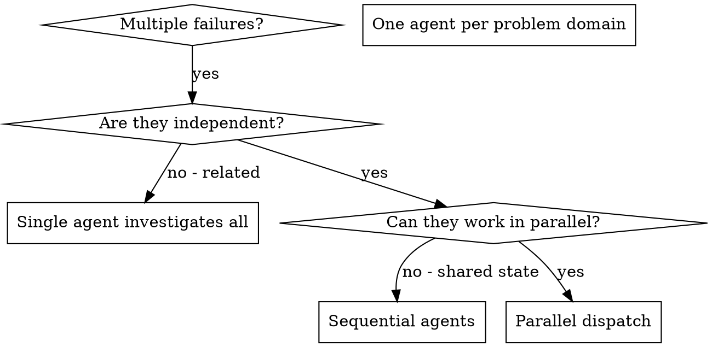

# Dispatching Parallel Agents

## Overview

You delegate tasks to specialised agents with isolated context. By precisely crafting their instructions and context, you ensure they stay focused and succeed at their task. They should never inherit your session's context or history — you construct exactly what they need. This also preserves your own context for coordination work.

When you have multiple unrelated failures (different test classes, different modules, different bugs), investigating them sequentially wastes time. Each investigation is independent and can happen in parallel.

**Core principle:** Dispatch one agent per independent problem domain. Let them work concurrently.

## When to Use



**Use when:**
- 3+ test classes failing with different root causes
- Multiple modules (core, separate contribs) broken independently
- Each problem can be understood without context from others
- No shared state between investigations

**Don't use when:**
- Failures are related (fix one might fix others) — e.g. many contribs failing after one core change: investigate the core change first
- Need to understand full system state
- Agents would interfere with each other (editing the same files, or running `mvn install` into the same `~/.m2` concurrently)

## The Pattern

### 1. Identify Independent Domains

Group failures by what's broken:
- `contribs/drt` `DrtPrebookingTest`: prebooking schedule status
- `contribs/emissions` `EmissionModuleTest`: missing warm emission factor lookup
- `matsim` `NetworkUtilsTest`: link length rounding

Each domain is independent — fixing DRT prebooking doesn't affect emission lookups.

### 2. Create Focused Agent Tasks

Each agent gets:
- **Specific scope:** One test class or module
- **Clear goal:** Make these tests pass
- **Constraints:** Don't change other code
- **Expected output:** Summary of what you found and fixed

### 3. Dispatch in Parallel

Call all agent invocations in a single response so they run concurrently.

> *[Copilot]* Use the `Task` tool: `Task(agent_type="task", prompt="...")`. For investigation-only tasks use `agent_type="explore"`.  
> *[Claude Code]* Use the `Agent` tool with multiple tool calls in one message: `Agent(subagent_type="general-purpose", prompt="...")`. For read-only exploration use `subagent_type="Explore"`. Agents that edit code concurrently should use `isolation: "worktree"`.

Example (all three dispatched in the same response turn):
```
Agent: Fix the 2 failing tests in contribs/drt DrtPrebookingTest — [paste error output here]. Do NOT change other modules. Return: root cause + what you changed.

Agent: Fix the failing test in contribs/emissions EmissionModuleTest — [paste error output here]. Do NOT change other modules. Return: root cause + what you changed.

Agent: Fix the failing test in matsim NetworkUtilsTest — [paste error output here]. Do NOT change other modules. Return: root cause + what you changed.
```

### 4. Review and Integrate

When agents return:
- Read each summary
- Verify fixes don't conflict
- Run the affected modules' suites
- Integrate all changes

## Agent Prompt Structure

Good agent prompts are:
1. **Focused** — one clear problem domain
2. **Self-contained** — all context needed to understand the problem
3. **Specific about output** — what should the agent return?

```markdown
Fix the 2 failing tests in contribs/drt/src/test/java/.../DrtPrebookingTest.java:

1. "testUnscheduleAfterRejection" — AssertionFailedError: expected status PLANNED, was STARTED
2. "testPrebookedRequestIsServed" — NullPointerException in PrebookingManager.notifyPassengerRequestRejected

Your task:

1. Make sure core is installed: mvn install --also-make --projects matsim -DskipTests -Dsource.skip
2. Run the tests: mvn test -pl contribs/drt -Dtest=DrtPrebookingTest -Dsurefire.failIfNoSpecifiedTests=false
3. Read the test class and understand what each test verifies
4. Identify the root cause (systematic-debugging skill)
5. Fix in contribs/drt main sources only

Do NOT change test files or other modules.

Return: Summary of root cause and exactly what you changed.
```

## Common Mistakes

**❌ Too broad:** "Fix all the tests" — agent gets lost  
**✅ Specific:** "Fix DrtPrebookingTest" — focused scope

**❌ No context:** "Fix the NPE" — agent doesn't know where  
**✅ Context:** Paste the full error output and test names

**❌ No constraints:** Agent might refactor everything  
**✅ Constraints:** "Do NOT change other modules"

**❌ Vague output:** "Fix it" — you don't know what changed  
**✅ Specific:** "Return summary of root cause and changes"

## When NOT to Use

**Related failures:** Fixing one might fix others — investigate together first  
**Need full context:** Understanding requires seeing entire system  
**Exploratory debugging:** You don't know what's broken yet  
**Shared state:** Agents would interfere (editing same files)

## Verification

After agents return:
1. **Review each summary** — understand what changed
2. **Check for conflicts** — did agents edit the same code?
3. **Run the affected suites** — verify all fixes work together (core first if it changed, then contribs):
   ```bash
   mvn install --also-make --projects matsim -DskipTests -Dsource.skip
   mvn verify -pl contribs/drt,contribs/emissions -Dmaven.test.redirectTestOutputToFile -Dmatsim.preferLocalDtds=true --fail-at-end -Dsource.skip
   ```
4. **Spot check** — agents can make systematic errors

---
Adapted from the `dispatching-parallel-agents` skill in [obra/superpowers](https://github.com/obra/superpowers), MIT licence.
